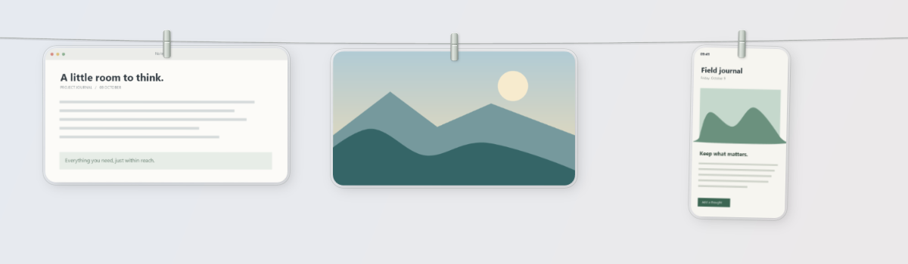
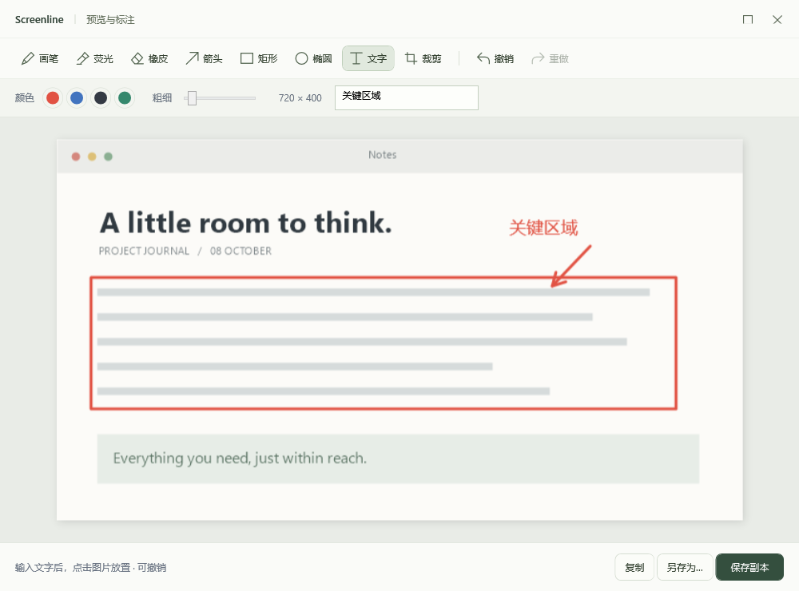
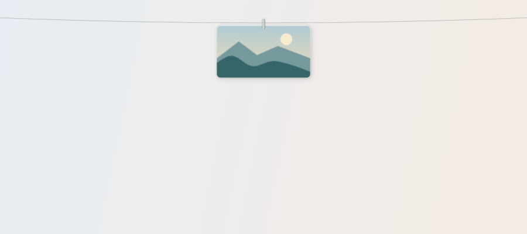

# Screenline · 截图晾台

**改编自 [Alejandro Buján](https://github.com/alejandrobujan) 的开源项目 [Tendedero](https://github.com/alejandrobujan/tendedero)，为 Windows 重新实现的截图晾衣绳工具。** 原项目的交互与产品设计归原作者；本项目用 C#、WPF、Win32 和 OLE 实现 Windows 适配，独立维护，不代表原作者或获得其背书。

An independent Windows adaptation of **Tendedero by Alejandro Buján**. Original concept and interaction design are credited to the upstream author. Screenline uses a different name, its own icon, and an independently implemented Windows codebase.

[下载 Windows 便携版](https://github.com/yzdashuaige111-eng/screenline-windows/releases/latest) · [操作说明](windows/README.md) · [性能报告](windows/qa-performance/REPORT.md) · [来源与署名](docs/ATTRIBUTION.md)

<picture>
  <source media="(prefers-color-scheme: dark)" srcset="windows/qa-gallery/evidence/gallery-dark.png">
  
</picture>

## 安装

在 [Releases](https://github.com/yzdashuaige111-eng/screenline-windows/releases) 下载 `Screenline-Windows-0.4.1.zip`，解压到可写目录，运行 `Screenline.exe`。

需要 **Windows 10/11 x64、.NET Framework 4.8**。当前实测环境为 Windows 11 25H2、200% 缩放；Windows 10 和混合 DPI 多显示器尚未完成设备验收。程序未签名。

无需安装、管理员权限、账号或网络。截图、设置和日志保存在程序旁的 `data/`；更新时保留该目录，退出程序后替换程序文件。

## 使用

| 操作 | 功能 |
|---|---|
| **Ctrl+Alt+S** | 拖选区域截图，松开后飞入晾台；Esc 取消 |
| **Ctrl+Alt+T** | 展开或收起晾台 |
| 鼠标停在屏幕顶边 | 展开；移开后自动收起 |
| 单击照片 | 复制原始分辨率图片 |
| 双击照片 | 打开预览 |
| 长按约 0.46 秒 | 打开标注：画笔、荧光笔、橡皮、箭头、矩形、椭圆、文字、裁剪、撤销与重做 |
| 拖动照片 | 向支持图片或文件的应用传递 PNG、位图与文件路径 |
| 托盘菜单 | 导入图片、设置剪贴板/目录监听、减少动画、退出 |

也可使用 **Win+Shift+S**，由剪贴板监听收纳；外部截图没有可靠的选区坐标。开启监听后会接收所有新的位图，可在设置中关闭。晾台保留最近 60 张记录；移除条目不删除导入的源文件。

## 预览与标注





以上图片和 GIF 均来自本项目程序与合成测试素材，不含原项目图标或文档图片。GIF 用于展示过程，不作为实际帧率测量。

## 0.4.1 性能优化

图片解码、哈希、PNG 编码和写盘移到后台，重复图片提前去重；截图飞入使用局部透明窗口，减少逐帧布局更新；缓存系统材质几何，修正透明窗口点击命中。

同机合成 3840 × 2160 图片，每版三次取中位数：

| 测量 | 0.4.0 | 0.4.1 |
|---|---:|---:|
| 图片收纳总耗时 | 787.22 ms | 406.94 ms |
| 收纳期间 UI 心跳最大间隔 | 787.28 ms | 31.57 ms |
| 重复图片收纳耗时 | 539.63 ms | 29.54 ms |

UI 心跳用于观察界面阻塞，不代表实际屏幕帧率。图片生成和屏幕像素读取不计入收纳耗时，结果仅代表本机合成图片测试。详见 [性能测量](windows/qa-performance/REPORT.md)。

## 构建与验证

Windows PowerShell / PowerShell 7，在仓库根目录运行：

```powershell
./windows/build.ps1
./windows/test-annotation.ps1
./windows/test-async-store.ps1
./windows/package.ps1
```

使用系统 .NET Framework C# 编译器与 WinRT 元数据，不需要 .NET SDK 或 NuGet。源码位于 [`windows/src`](windows/src)，测试源码位于 [`windows/tests`](windows/tests)。Pillow 仅用于生成图标和处理验收图片，发行程序不依赖 Python。

2026-10-11 的本机最终程序通过 **94 项**功能、真实鼠标交互、跨进程拖拽、截图像素、标注和材质检查。详见 [验收结果与覆盖边界](windows/QUALITY.md) 和 [发行校验清单](delivery-manifest-v0.4.1.json)。这些检查不能代替对所有设备和目标应用的验证。

需要鼠标与桌面操作的测试及历史性能对照见 [开发与验收说明](docs/DEVELOPMENT.md)。

## 来源与授权

- 原项目：**[alejandrobujan/tendedero](https://github.com/alejandrobujan/tendedero)**，作者 **Alejandro Buján**。
- 适配依据的原始提交：[`ed0618a`](https://github.com/alejandrobujan/tendedero/tree/ed0618a67cc59e0a8621b97bb5e32ab9af3b0b69)。
- 代码按 [MIT License](LICENSE) 发布；原作者版权与完整原始授权见 [THIRD-PARTY-NOTICES.txt](THIRD-PARTY-NOTICES.txt)。
- 原项目名称、图标和文档图片不属于其代码的 MIT 授权范围。Screenline 使用不同名称、自己生成的图标与测试图片。

感谢原作者开源 Tendedero。
